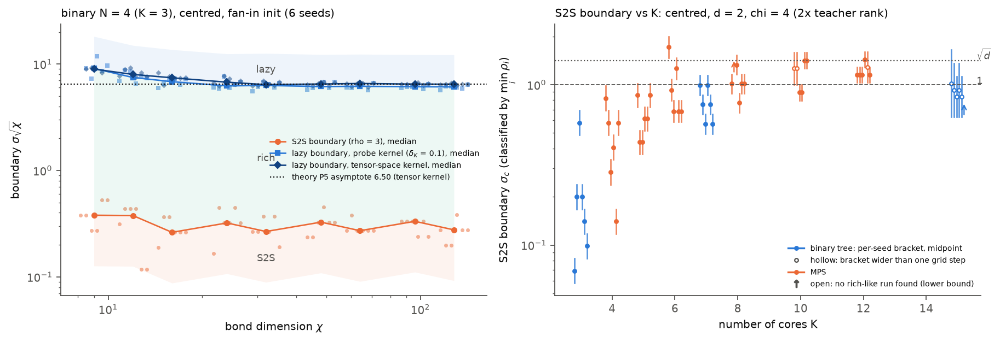

# regime-map: phase diagrams of TTN training regimes (Q5)

> **Addendum, fix round 1 (2026-10-10, local).** Several claims below were corrected after review
> round 1 (`notes/reviews/regime_map_round1.md`). The authoritative list, old -> new with status tags,
> is **`notes/regime_map.md` section 3 "Fix round 1 (local)"**; tables and figures are in
> `experiments/regime_map/results/fix1/`, and every figure in `results/` was regenerated from the
> copied raw outputs (`data/regime_map/`). In short: (1) events now use the last crossing of 1/2 before
> a component is learned (15 labels change, all rich -> S2S; chi = 12 seed 4: 0.013 -> 0.034); the
> deepest-run "prediction" is a calibrated consistency check of rho ~ 1/sigma, not an a-priori
> prediction; with the tensor-space kernel the lazy boundary lies in P5's bracket at chi = 24-96 and
> at its lower edge at 128 (the 128-probe kernel of the labels gives ~5% lower boundaries). (2) The sigma sqrt(chi) collapse is
> empirical for N = 4, fan-in, chi = 16-128 (< 1 decade), the TTN analogue of known width scales.
> (4) K >= 8 boundaries were floor-limited brackets (5/6, 5/6, 6/6, 5/6 seeds unresolved at K = 8,
> 10, 12, 15); sigma_c -> sqrt(d) is a conjecture. (5) With the tensor kernel, muP-TTN delta_K -> 6.2
> and NTK ~ chi^-1 at chi >= 64, as P16 predicts. (6) P20's slope and saturation hold with the tensor
> kernel; "S2S widest at lambda = sqrt(chi)" is withdrawn. Pending: section 3.3 of the notes.

Status: done - Branch: agent/regime-map - Updated: 2026-10-10 06:59 UTC

## Summary
Asked: phase diagrams of saddle-to-saddle (S2S), rich non-incremental and lazy gradient-flow dynamics of
TTNs over init scale sigma, bond dimension chi, number of cores K and core imbalance, with predicted
boundaries and threshold sensitivity. Found (about 9,000 gradient-flow runs, 6 seeds per point,
per-seed statistics):
(1) Binary N = 4 (K = 3): every boundary is predicted quantitatively. The S2S boundary of each seed is
predicted from that seed's deepest run alone (0.97-1.08x for chi >= 6). rho scales as sigma^-1.03 per
seed (predicted -1). The lazy boundary follows the second-order law sigma_lazy = 6.50 / sqrt(chi) of
theory_regimes P5 to 4-8%.
(2) At large chi both boundaries scale as chi^-1/2, so the map collapses in sigma sqrt(chi), the
per-bond Gram scale. Neither sigma^K nor sigma^K chi^(K-1) collapses it. The rich window is a fixed
factor of ~21 in sigma.
(3) A lazy regime exists only when every bond reaches the cut dimension. Below it the centred target is
unrealizable and runs stall exactly at the Eckart-Young floor.
(4) With K the S2S boundary rises from 0.17 (K = 3) to ~0.9-1.0 (K = 8-12). The K-stable variable is
the per-component amplitude sigma^K / sqrt(D) ~ 0.01, which implies sigma_c -> sqrt(d), not 1 (H4
refined). Stalls take over the S2S side for MPS trees and when chi equals the teacher rank.
(5) Large chi: feature learning survives only under muP-TTN (delta_K ~ chi^0.03, vs chi^-3.09 for SP
and chi^-0.84 for NTK), as theory P16 predicts.
(6) Imbalance: a light root makes training lazy (delta_K ~ lambda^2); a heavy root does not. S2S is
widest near the balance point lambda = sqrt(chi).

## Results
All numbers: whitened inputs, exact population loss, odeco teacher [3, 2, 1] (d = 3) or [3, 2]
(d = 2), fan-in init, gradient flow with the shared library (DP5 rtol 1e-8 / atol 1e-12, LSODA for long
stiff plateaus), every event re-integrated on a dense linear grid, 6 seeds per point. Raw runs:
`/root/outputs/regime_map/<exp>/` (1.2 GB). Figures and tables: `experiments/regime_map/results/`,
all regenerated by `uv run python experiments/regime_map/make_figures.py --force` from the raw runs.
Derivations, per-seed tables and status tags: `notes/regime_map.md` (section numbers below; section 0
is the "which parameter moves which boundary" table).

**(a) sigma x chi, binary N = 4 (K = 3)**: `sigma_chi_b4`, 8 chi x 19 sigma in [0.01, 40], centred,
plain and two-copy models, 2736 runs, notes 2.1. Figure `phase_sigma_chi_b4_centred.png`.

| chi | S2S boundary (per seed) | predicted from deepest run | rho exponent (S2S side) | kernel boundary (dK = 0.1) | rho 2/5 ratio | dK 0.05/0.2 ratio |
|---|---|---|---|---|---|---|
| 3 | 0.236 | 0.283 | -1.056 +- 0.022 | stalled (floor) | 2.15 | - |
| 6 | 0.137 | 0.143 | -1.030 +- 0.004 | stalled (floor) | 2.22 | - |
| 9 | 0.136 | 0.141 | -1.030 +- 0.004 | 3.01 | 2.27 | 1.89 |
| 18 | 0.072 | 0.073 | -1.031 +- 0.000 | 1.66 | 2.30 | 1.46 |
| 36 | 0.043 | 0.044 | -1.034 +- 0.003 | 1.04 | 2.34 | 1.33 |

**Threshold sensitivity.** Predictions: (5/2)^(1/(K-2)) = 2.5 for the S2S boundary; 4^(1/(Ks)) for
the kernel boundary, with local slope s between 1 and 2 (theory P7: 1.3-1.36 at chi >= 32). The
regime labels are robust to the thresholds; only the boundary positions shift, as predicted.

**Realizability.** Below the cut dimension every stalled run (44) ends at the Eckart-Young minimum of
W_0 + W* (to 1e-6).

**(b) Boundaries vs chi, N = 4**: `chi_b4`, chi = 9..128, 1428 runs, notes 2.1b. Figure
`boundaries_vs_chi_chi_b4.png`.

| | slope vs chi | sigma sqrt(chi) at the boundary | theory |
|---|---|---|---|
| S2S boundary | -0.524 +- 0.045 (chi 16-128, 42 seeds) | 0.27-0.31 | not derived |
| lazy boundary, centred | -0.522 +- 0.020 (chi 32-128) | 6.10-6.29 | -1/2; 6.50 (P5) |
| lazy boundary, two-copy | -0.514 +- 0.023 | 4.83-4.96 | -1/2; 5.16 (P6) |

**(c) sigma x K**: `sigma_K_centred_d2` and `sigma_K_d2`/`sigma_K_full_d2`, d = 2, binary N = 4, 8,
16 and MPS N = 4..12; notes 2.3. Figures `phase_sigma_K_centred_d2_chi4.png` and `sigma_c_vs_K.png`
(table `sigma_c_vs_K.csv`), and `stalls_vs_K.png`.

| K | 3 | 4 | 5 | 6 | 7 | 8 | 10 | 12 | 15 |
|---|---|---|---|---|---|---|---|---|---|
| sigma_c, centred chi = 4 (median) | 0.17 | 0.49 | 0.61 | 0.80 | 0.75 | 1.01 | 0.90 | 0.92* | [0.63, 1.36]* |
| law (0.01 d^(N/2))^(1/K) | 0.34 | 0.45 | 0.56 | 0.66 | 0.77 | 0.80 | 0.89 | 0.96 | 1.07 |

\* Unresolved: the next run up is floor-stalled, so the boundary lies in the bracket.

- In alpha = sigma^K the boundary is not K-stable (alpha_c from 0.005 to ~1).
- In sigma^K / sqrt(D) it is: about 0.01 for K >= 4.
- Hence sigma_c -> sqrt(d), not 1, with x_i ~ N(0, I_d). This is derived from theory R9's
  effective-amplitude law plus the measured constant. The K = 15 bracket [0.63, 1.36] contains both
  1 and the predicted 1.07.
- The plain model agrees with the centred one up to K = 8. Beyond that it collapses W_0 first and
  then learns S2S from a small residual, so it is not a test of H4.

**(d) K = 7 maps (binary N = 8)**: `sigma_chi_b8` (d = 3) and `sigma_chi_b8_d2` (d = 2); notes 2.6.
Figures `phase_sigma_chi_b8*.png`.

| tree / bonds | S2S boundary (median) | large sigma |
|---|---|---|
| d = 3, chi = 24 (deficient) | 0.54 | rich at 0.65-0.93; no lazy regime (floor-stalled from 1.3) |
| d = 2, chi = 4, 8, 16 | 0.83 | floor-stalled (deficient chi) or an unfinished, ill-conditioned lazy fit (square chi = 16; P9) |
| d = 2, bonds 8/32 (2x cut dimension) | 0.53 | **lazy from ~1.4** (kernel boundary 1.45) |

**(e) Large chi** (N = 4, sigma = 1.5): `large_chi_b4`, notes 2.5. Figure
`large_chi_large_chi_b4_centred_sigma1.5.png`.

| slope vs chi (chi 16-128) | delta_K | delta_theta | root change |
|---|---|---|---|
| SP (theory -3, -3/2, -1) | -3.09 +- 0.09 | -1.63 +- 0.04 | -1.02 +- 0.03 |
| NTK (-1, -1/2, -1) | -0.84 +- 0.06 | -0.52 +- 0.03 | -0.93 +- 0.02 |
| muP-TTN (0, 0, -1/2) | +0.03 +- 0.06 | -0.06 +- 0.02 | -0.50 +- 0.01 |

**(f) Imbalance** (N = 4): `imbalance_b4`, notes 2.4. Figure `phase_imbalance_b4.png`.
- At chi = 16, alpha = 3.375, delta_K goes from 1e-4 (lambda = 0.01) to 0.167 (lambda = 1) and
  saturates at 0.50-0.53.
- Local slope 2.18 -> 1.27 (theory P20: 1.8-1.9; saturation predicted 0.6-0.7).
- At chi = 24 a light root moves the lazy boundary down by ~100x in alpha.
- The S2S region is largest near lambda = sqrt(chi).

**(g) Stalls at chi = teacher rank** (stall test, K = 7, 8; notes 2.2).

| tree, init (plain model) | converged | dead routes |
|---|---|---|
| binary 8, fan-in | 4/18 | 12/18 |
| MPS 8, fan-in | 0/18 | 16/18 |
| binary 8, gauge-balanced | 6/18 | 0 |

With gauge-balanced init the route still decays, which agrees with P14.

**(h) Two-copy cross-check** (notes 2.x):
- Same lazy residual as the centred model.
- Kernel change is second order, so the lazy boundary is lower, as P6 predicts.
- At small sigma the two mirror copies escape together and merge events 1-2, so the S2S side cannot
  be compared at large chi.
- At deficient bonds and large sigma it escapes from the lazy residual (lazy-then-rich).

**(i) Checks** (notes 2.y):
- scipy RK45 vs library DP5 on 1937 matched runs: labels agree 98.1%, delta_K to 0.08%.
- Conservation drift <= 1e-9.
- Every N = 4 event width is resolved.
- At K >= 7 deep in the S2S region widths are unresolved. rho there is a lower bound, and no label
  depends on it.
- The direct centred loss (small alpha) matches the cancellation-free form to 1e-4 in event times.

## What was done
Commit hashes on `agent/regime-map`:
1. Theory draft and pilots: lazy residual, lazy coefficients vs chi, two-copy second-order kernel
   change (49f8580, 60bf327, 9696394, 7a71905).
2. Interim scipy driver and first N = 4 map; interim report (e995bb7, d675177, 7832b4a).
3. Library driver `run_regime.py`, `sweep.py` and YAML configs, with linear-time event refinement
   (28d1826).
4. Stall tests, gauge-balanced init, output-dir options and per-seed analysis (b556c44, a910af2,
   0e62c41).
5. Fixes and restarts:
   - convergence reference 1/2 ||W*||^2, single-threaded BLAS (2230955);
   - cost-controlled configs, sigma x K at d = 2 (c874913, 49f3f53, 1465852, f7cc0e0, e326b9a);
   - centred K sweep (8da6cde);
   - direct centred loss (80022b0);
   - sigma-descending order (6b20cb7).
6. Analysis and figures: thresholds, chi boundaries, large chi, imbalance, sigma_c vs K, resolution
   flags, summary (671643b, b276eca, cf7f272, a8bea1b, bb84947).
7. Notes `notes/regime_map.md` sections 0-2 (769db99, f5cbaef, de31177, f501a14, 23fa63b,
   5a41232, d10e93f) and README (7790c16).

## Decisions
1. **d = 3, odeco teacher [3, 2, 1]** (minimal d for 3 odeco components; keeps the cut dimension
   small: 9 for N = 4, 81 for the top cut of N = 8, so full bonds are reachable). Alternative d = 4/5
   would make full bonds unaffordable for N = 8.
2. **N = 4 bond dimensions uncapped** (`cap=False`), chi in {3,4,6,9,12,18,24,36}: chi = 9 is the
   cut dimension (full, square cores, ill-conditioned), chi > 9 are overparameterized bonds, which is
   what the brief's "up to 8x the teacher rank" requires. N = 8 uses capped bonds (bottom bonds <= 9),
   since uncapped middle cores chi^3 are unaffordable at chi = 81.
3. **Interim integrator.** The library's dynamics/runner had not landed when the first diagram was
   due, so the interim sweeps use scipy RK45 (rtol 1e-9, atol 1e-14) on the flat parameter vector,
   as the brief allows for pilots, with an explicit time budget (README). They will be rerun or
   spot-checked with `ttn.dynamics` when it lands.
4. **All pilot results computed before the core-fix merge (teacher stream bug) were discarded**; the
   pilots had used teacher seed 1000 + s vs init seed s, but every number in this report is from
   runs after merging 57d5262.
5. **Stalled runs are split** (in figures only; the official label stays "stalled") into
   delta_K < 0.1 (kernel-like stall at the lazy residual, a representability effect) and
   delta_K >= 0.1 (feature-learning stall), because below the cut dimension the centred target
   W* + W_0 is unrealizable (theory R6) and "stalled" otherwise mixes two different mechanisms.
6. **Teacher seed = 1000 + init seed**, so seeds vary both; by the O(d) invariance of the init the
   teacher basis is statistically irrelevant, so this costs nothing and avoids any shared stream.
7. **Event widths are re-measured in linear time.** A log-time recording grid (1% spacing) cannot
   resolve O(1)-wide events at late times (at t ~ 4e5 on K = 7 the spacing is ~1e4), which made rho
   come out 1000x too small. Each final rise is re-integrated from the saved parameters on a
   200-point linear grid (`run_regime.refine_events`); deep-S2S widths then match the aligned theory
   to 3 digits (0.466, 0.798, 2.010 vs 0.46, 0.80, 2.01 for s = 3, 2, 1, K = 3).
8. **Integrators.** LSODA (exact Hessian) where P <= ~2500 (all of sigma x K; N = 8 with chi <= 12),
   dopri5 otherwise; N = 8 runs with large P start at sigma = 0.3-0.4, where later plateaus are still
   ~1e2-1e3 time units (deep S2S for K = 7: rho ~ 3 (0.9/sigma)^5).
9. **sigma_min(K) = 10^(-8/K)** in the sigma x K sweep so that initial component amplitudes ~sigma^K
   stay ~1e-8 or larger, far above the float64 floor of the gradient (lead's note); runs record the
   smallest dormant overlap at the first event (`dormant_min`).
10. **Interim scipy sweep superseded.** The first N = 4 sigma x chi map (2460 runs, scipy RK45) is
    kept in /root/outputs/regime_map/b4_sigma_chi as an integrator cross-check; all reported numbers
    come from the library runs (ttn.dynamics) with event refinement.
11. **Convergence is judged against 1/2 ||W*||^2, not L(0).** For the centred and two-copy models
    these are equal. For the plain model at large sigma, L(0) ~ 1/2 ||W_0||^2 >> 1/2 ||W*||^2, and the
    literal rule "L(T) < 1e-3 L(0)" (and a stop floor relative to L(0)) would call a run converged
    after it merely shrank W_0, before any teacher component is learned (seen: K = 15, sigma = 2, no
    events). Plain rows with L(0) > 100 x 1/2 ||W*||^2 computed under the old floor were discarded and
    rerun; the others were rescaled (the analysis recomputes labels from l_end).
12. **Gradient-flow budget is not unlimited**: runs stop at the time budget T or at max_steps
    (1e5; 3e4 for N = 8), whichever comes first. Runs stopped there unconverged are 'stalled' by the
    rule and are reported as such, with the stall type from the bond spectra (dead route: R-th bond
    singular value < 1e-12; long plateau: >= 1e-4; decaying: in between).
13. **K = 7 lazy region mapped at d = 2.** At d = 3 the top cut of binary N = 8 has dimension 81: full
    bonds mean square 81 x 81 cores (lazy fit needs tau ~ 1e5, theory P9) or 1.3e5 parameters for
    2x-overparameterized bonds (~1 s per gradient under load). The d = 3 map (teacher [3, 2, 1]) keeps
    the deficient bonds chi = 3..24 (centred and plain); a second map at d = 2 (teacher [3, 2], cut
    dimensions 4 and 16) has chi = 2, 4, 8, 16 (full, square) and 8 / 32 (full, 2x), where the lazy
    regime exists. Same for the large-chi study at K = 7 (d = 2, as in theory P17).
14. **sigma x K uses the plain model with chi = 6 (= 2 x teacher rank) plus a chi = 3 slice**, after
    theory v2 and the stall test: at chi = 3 most K >= 7 runs never learn the last component (dead
    routes), and the centred target is floored near the expected boundary. For K >= 10 at chi = 6 the
    sigma grid is a window around the predicted boundary (0.4-1.6) integrated with dopri5, because
    LSODA's Hessian costs ~5 min per evaluation for P ~ 1800 under full load.
    *Revised 22:10:* those dopri5 runs stopped at their step cap mid-plateau (stiff after the first
    escape), so the full K range is now mapped at **d = 2** (teacher [3, 2], chi = 4 = 2R and chi = 2 = R;
    <= 600 parameters, LSODA everywhere; `configs/sigma_K_d2.yaml`), as in theory P15. The d = 3 sweep
    keeps K <= 8 (chi = 3, 6) and the chi = 3 stall slice up to K = 15.
15. **Centred model with small W_0 uses the direct loss** 1/2 ||W - (W* + W_0)||^2 (alpha = prod sigma_v
    < 1e-2; `run_regime.ShiftedCP`). Its cancellation error is ~1e-16 alpha^2, and the cancellation-free
    doubled-bond form costs 4.5x per gradient and 14x per Hessian (binary 16 under load: 0.21 s vs 0.05 s,
    47 s vs 3.3 s). Checked on two configurations: identical labels, event times to 1e-4, delta_K to
    6 digits. Overlaps and spectra then refer to W instead of W - W_0 (difference O(alpha / sqrt(D))).
16. **Dropped the rest of the d = 3 sigma x K sweep for K <= 8** (252 runs done) when the heavy pool
    was projected at > 5 h; the d = 2 plain, full-bond and centred sweeps cover the K dependence.
17. **Cost.** The full program is ~9,000 gradient-flow runs; the heavy part (K >= 7 with LSODA or the
    centred loss) dominates: 20-60 min per run under full load. Machine time so far ~8.5 h on 368 vCPUs.

## Files left on the machine
`/root/outputs/regime_map/` (1.2 GB) holds one directory per experiment with `results.jsonl` (one
summary row per run) and `traj/*.npz` (library `Trajectory` per run). All are needed to regenerate the
figures with `make_figures.py`, and all can be regenerated by `sweep.py` (seeded; ~10 h on 368 vCPUs).

| experiment | size |
|---|---|
| chi_b4 | 184 MB |
| sigma_chi_b4 | 171 MB |
| sigma_K_d2 | 156 MB |
| sigma_K_centred_d2 | 155 MB |
| sigma_chi_b8_d2 | 132 MB |
| imbalance_b4 | 90 MB |
| sigma_chi_b8 | 75 MB |
| sigma_K_full_d2 | 60 MB |
| sigma_K | 53 MB |
| large_chi_b4 | 49 MB |
| b4_sigma_chi (interim scipy runs) | 44 MB |
| large_chi_b8 | 30 MB |
| stall_test | 11 MB |
| pilots, test* (throwaway) | 2 MB |

## Caveats and next steps
- **Unfinished runs at the cut-off** (06:56 UTC; deep-S2S points were run last on purpose):

  | experiment | finished | what is missing |
  |---|---|---|
  | sigma_chi_b8 | 227/240 | |
  | sigma_chi_b8_d2 | 375/390 | 8/32 bonds at large sigma: 9 runs |
  | sigma_K_centred_d2 | 827/912 | full-bond binary 8 and MPS 8; binary 16 at sigma 0.76-0.92, so its boundary is only bracketed |
  | sigma_K_full_d2 | 220/228 | |
  | large_chi_b8 | 71/72 | |
  | sigma_K_d2_large | 333/408 | |
  | sigma_K_large | 67/168 | |
  | stall_test chi = 6 variants | 66/126 | |

  Finished runs are analysed as they are; the per-seed tables give the seed counts behind every number.
- **Design limits.**
  - The d = 3 sigma x K sweep was dropped beyond the 252 finished runs; the K dependence comes from
    d = 2.
  - The sqrt(d) limit is tested at d = 2 only.
  - Large-chi results are for N = 4; the K = 7 large-chi runs at d = 2 were noisy and are not
    interpreted.
- **Time budgets.** "Stalled" mixes three causes: floors (unrealizable), dead or long routes, and
  unfinished lazy fits at square cores. The notes separate them case by case. A fixed budget
  necessarily truncates the escape times that grow with K.
- **Interim numbers** of the first report (scipy, log-time grid) are superseded; they are kept in
  `results/interim/`.
- **Next steps.**
  - Test sigma_c -> sqrt(d) at d = 3 with spare channels.
  - Measure the effective amplitude c_K directly from first escapes.
  - Derive the chi^-1/2 scaling of the S2S boundary.
  - Run deeper trees at large chi under muP-TTN.
  - Add a two-copy S2S comparison at small chi.

## Log
- 18:18 started; read brief and notes; merged origin/main; machine has ~368 CPUs (cgroup quota), 125 GB RAM
- 18:25 theory draft in notes/regime_map.md: centred-model lazy limit only fits W* at maximal bond dimension (lazy residual), delta_K ~ kappa/sigma^K, rho ~ sigma^-(K-2), imbalance rule
- 18:30 pilot (scipy RK45) binary N=4 sigma x chi, 2 seeds: S2S at small sigma, lazy at large sigma for chi >= 9; final loss = best rank-chi approx of W0+W* (exact); delta_K matches kappa/sigma^3 to <1% at sigma >= 3 when converged
- 18:45 merged main (core fixes: teacher stream, cancellation-free centred loss); discarded old pilots; read literature.md (H4 corrections) and draft theory_regimes.md (agrees with my derivations; adds muP-TTN, exact aligned S2S boundary)
- 18:52 launched interim sweep b4_sigma_chi (N=4, centred/plain/two-copy, 8 chi x 19 sigma x 6 seeds = 2736 runs)
- 19:10 interim N=4 map: S2S / rich / lazy (chi >= 12) / stalled (chi < 9, unrealizable); per-seed S2S boundary predicted within one grid step by aligned-mode extrapolation from the deepest run; two-copy merges events 1-2 (mirror copies escape together)
- 19:20 merged library v0; wrote run_regime.py + sweep.py + YAML configs; found log-grid width resolution problem, added linear-time event refinement
- 19:54 launched production sweeps (library): sigma_chi_b8 (462), sigma_K (768), sigma_chi_b4 (2736); queued imbalance_b4, large_chi_b4, large_chi_b8
- 20:05 LSODA fails at huge sigma^K (K = 15, sigma = 10); added auto method (LSODA below sigma 0.7) with dopri5 fallback, max_steps caps, trimmed sigma ranges where deficient-bond runs only stall; relaunched (390 + 666 + 2736 runs)
- 20:15 interim report: N = 4 sigma x chi map with predicted S2S, lazy and realizability boundaries
- 20:25 all K >= 7 runs at chi = 3 (= teacher rank) stall; paused sweeps; added gauge-balanced init (balance.py); stall test (binary/MPS N = 8, fan-in vs balanced, chi = 3 vs 6, centred vs plain)
- 20:30 merged analysis standards + theory_regimes v2 (stalls at chi = R, centred floor at deficient bonds, second-order lazy boundary); revised configs: sigma x K in the plain model with chi = 3 and 6; chi_b4 to chi = 128; imbalance check point; added output-dir options, per-seed boundary functions, stall classification from bond spectra
- 20:38 stall test (plain, K = 7/8, chi = 3, 3 sigma x 6 seeds): fan-in 12/17 (binary) and 11/13 (MPS) dead routes (3rd bond singular value < 1e-12); balanced init: 0 dead but 12/17 still unconverged (route decaying, s_3 ~ 3e-5) - agrees with theory P14
- 20:55 library vs scipy integrators on 1937 matched N = 4 runs: labels agree 98.1%, delta_K 0.08%, drift <= 1e-9
- 21:02 load ~1900: LSODA workers spawned BLAS threads; pinned OMP/OpenBLAS/MKL threads to 1 in sweep.py and restarted (resumable)
- 21:08 plain-model convergence/stop floor now relative to 1/2 ||W*||^2 (decision 11); dropped 140 affected plain rows; relaunched all sweeps (5516 runs to do)
- 21:45 library N = 4 data: per-seed rho exponent on the S2S side -1.03 (seed sd 0.001-0.09) vs predicted -(K-2) = -1 (interim log-grid data had given -0.5..-0.7); continuous per-seed threshold sensitivity
- 21:55 heavy runs infeasible under load (binary16 chi = 6 Hessian 330 s, N = 8 chi = 81 gradient 0.2 s); stopped and restructured (decisions 13-14); relaunched 5749 runs
- 22:10 d = 3 K >= 10 runs at chi = 6 stopped at step caps mid-plateau; moved the K sweep to d = 2 (sigma_K_d2, 1428 runs, P <= 600, LSODA); relaunched
- 22:15 added full-bond K subset at d = 2 (sigma_K_full_d2); README rewritten
- 22:38 N = 8 runs 10-30+ min each and N = 4 studies queued behind them: restarted as two pools (N = 4: 140 procs; heavy: 215 procs) with trimmed N = 8 grids (sigma >= 0.3 at K = 7, chi = 12 dropped at d = 3, MPS 10 dropped from the full-bond set)
- 23:25 heavy pool was spending its slots on K >= 10 stall runs; restarted it with the N = 8 maps and K <= 8 first (220 procs); K >= 10 slices (step cap 1e4) chained to start when the N = 4 pool ends
- 23:45 plain-model K sweep: at large sigma the run first collapses W_0 (loss / (1/2||W*||^2) from 187 to ~1 by t ~ 0.1 at K = 15, sigma = 1.36) and then learns saddle-to-saddle from the small residual scale, so the plain-model S2S region extends beyond sigma = 1 (binary 16, chi = 4: S2S 5/6 at sigma = 1.36) - not a test of H4; added a centred K sweep at d = 2 (sigma_K_centred_d2), chained after the N = 4 pool
- 00:35 chi_b4 (N = 4, chi = 9..128, partial): lazy boundary 0.903 / 0.769 / 0.627 / 0.535 at chi = 48 / 64 / 96 / 128 vs theory P5 6.50 chi^-1/2 = 0.938 / 0.812 / 0.663 / 0.575 (two-copy 0.87 / 0.61 / 0.42 vs 0.91 / 0.65 / 0.46); threshold ratio 1.30-1.33 (P7); S2S boundary also ~chi^-1/2 at large chi: both collapse in sigma sqrt(chi) (S2S ~0.28, lazy ~6.1)
- 00:45 large_chi_b4 (partial): exponents of delta_K vs chi: SP -2.95 +- 0.16 (theory -3), NTK -0.76 +- 0.11 (-1), muP-TTN +0.15 +- 0.16 (0)
- 01:25 chi_b4 complete: lazy boundary slope -0.522 +- 0.020 (chi >= 32; theory -1/2), S2S boundary slope -0.524 +- 0.045 (chi 16-128): collapse in sigma sqrt(chi) (per-bond Gram scale); large_chi_b4 complete (sigma = 1.5): SP -3.09 +- 0.09, NTK -0.84 +- 0.06, muP-TTN +0.03 +- 0.06 for delta_K vs chi
- 01:37 started the centred sigma x K sweep (d = 2) alongside the N = 4 tail (two-copy deficient escapes at large sigma)
- 01:52 heavy pool too slow (~1350 runs left at ~4/min): dropped the remaining d = 3 sigma x K runs (K <= 8; 252 done, d = 2 sweeps cover K); restarted heavy pool with the N = 8 maps, the d = 2 plain and full-bond K sweeps and large-chi K = 7
- 02:55 centred loss with small W_0 switched to the direct form (decision 15, verified); restarted the heavy pool with the centred sigma x K sweep included (1885 runs)
- 04:55 heavy pool down to ~1 run/min (in-flight K = 10-12 deep-S2S centred runs); restarted it in sigma-descending order (boundary and lazy regions first, deep S2S points last)
- 06:20 centred sigma x K: boundary set by the per-component amplitude sigma^K / sqrt(D) ~ 0.01 -> sigma_c -> sqrt(d)
- 06:56 cut-off: stopped the remaining sweeps (deep-S2S points, some K = 7 large-sigma runs); listed unfinished runs per config
- 06:58 per-seed S2S brackets; summary figure; all figures regenerated from the final data; notes sections 0, 2.3, 2.6 and report finalized
