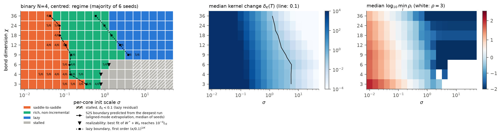
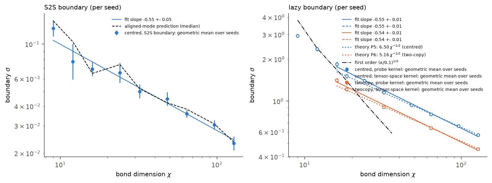
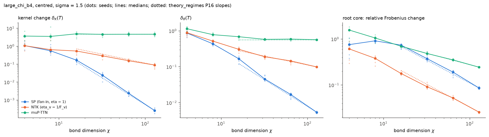

# regime-map: phase diagrams of TTN training regimes (Q5)

Status: working - Branch: agent/regime-map - Updated: 2026-10-10 02:45 UTC

## Summary
Task: phase diagrams of saddle-to-saddle (S2S), rich non-incremental and lazy dynamics over init scale
sigma, bond dimension chi, number of cores K and root imbalance, with predicted boundaries and threshold
sensitivity. Main findings so far (gradient flow, shared library, linear-time event refinement; numbers
are per-seed statistics over 6 seeds):
(1) **Binary N = 4 (K = 3):** all boundaries are predicted quantitatively. The S2S boundary of each seed
is predicted from that seed's deepest run alone (pred / measured 0.97-1.08 for chi >= 6), rho scales as
sigma^-1.03 per seed (predicted -(K-2) = -1), and the lazy boundary follows the second-order law of
theory_regimes P5 (sigma_lazy sqrt(chi) = 6.1-6.3 vs 6.50; two-copy 4.8-5.0 vs 5.16).
(2) **Both boundaries scale as chi^-1/2** (S2S -0.52 +- 0.05, lazy -0.52 +- 0.02, chi = 16/32-128), so at
large chi the map collapses in sigma sqrt(chi), the per-bond Gram scale; sigma^K and "per-path amplitude x
paths" are rejected as collapse variables. The rich window is a fixed factor ~21 in sigma.
(3) **The lazy regime exists only at full bonds** (chi >= cut dimension); below it the centred target is
unrealizable and runs stall exactly at the Eckart-Young floor of W_0 + W*.
(4) **Large chi:** delta_K ~ chi^-3.09+-0.09 (SP), chi^-0.84+-0.06 (NTK), chi^+0.03+-0.06 (muP-TTN: feature
learning survives), matching theory P16.
(5) **Imbalance at fixed alpha:** a light root makes training lazy (delta_K ~ lambda^2, slope 1.86 vs
theory 1.8-1.9), a heavy root does not (delta_K saturates at 0.5); the S2S region is largest near the
expected-balance point lambda = sqrt(chi).
(6) **Stalls:** at chi = teacher rank and K >= 7 most runs never learn the last component (dead routes
with fan-in init; balanced init removes dead routes but not the stall). Still running: the N = 8 maps
(d = 3 deficient bonds; d = 2 full bonds) and the sigma x K sweeps (plain and centred, d = 2).

## Results
All numbers: whitened inputs, exact population loss, odeco teacher [3, 2, 1] (d = 3) or [3, 2] (d = 2),
fan-in init, gradient flow with the shared library (DP5 rtol 1e-8 / atol 1e-12, LSODA for long stiff
plateaus), events re-integrated on a dense linear grid; 6 seeds per point. Raw runs:
`/root/outputs/regime_map/<exp>/`; figures and tables: `experiments/regime_map/results/`, regenerated by
`uv run python experiments/regime_map/make_figures.py`. Details and derivations: `notes/regime_map.md`
(section numbers below).

**(a) sigma x chi, binary N = 4** (`sigma_chi_b4`, 8 chi x 19 sigma in [0.01, 40]; notes 2.1):

| chi | S2S boundary (per seed, geo-mean) | predicted from deepest run | rho exponent (S2S side) | kernel boundary (dK = 0.1) | rho 2/5 ratio | dK 0.05/0.2 ratio |
|---|---|---|---|---|---|---|
| 3 | 0.236 | 0.283 | -1.056 +- 0.022 | stalled (floor) | 2.15 | - |
| 6 | 0.137 | 0.143 | -1.030 +- 0.004 | stalled | 2.22 | - |
| 9 | 0.136 | 0.141 | -1.030 +- 0.004 | 3.01 | 2.27 | 1.89 |
| 18 | 0.072 | 0.073 | -1.031 +- 0.000 | 1.66 | 2.30 | 1.46 |
| 36 | 0.043 | 0.044 | -1.034 +- 0.003 | 1.04 | 2.34 | 1.33 |

Threshold sensitivity: predicted (5/2)^(1/(K-2)) = 2.5 asymptotically for the S2S boundary (measured
2.15-2.34; the O(1) term of rho lowers it) and 4^(1/(Ks)) for the kernel boundary with local slope s
from 1 to 2 (measured 1.89 -> 1.33 as chi grows; theory P7: 1.3-1.36 at chi >= 32). Figures
`sensitivity_sigma_chi_b4_*.png`, per-seed tables `sensitivity_per_seed_*.csv`.

**(b) Boundaries vs chi, binary N = 4** (`chi_b4`, chi = 9..128; notes 2.1b):

| | slope vs chi | theory |
|---|---|---|
| S2S boundary | -0.524 +- 0.045 (chi 16-128, 42 seeds) | - |
| lazy boundary, centred | -0.522 +- 0.020 (chi 32-128); sigma_lazy sqrt(chi) = 6.10-6.29 | -1/2; 6.50 (P5) |
| lazy boundary, two-copy | -0.514 +- 0.023; sigma_lazy sqrt(chi) = 4.83-4.96 | -1/2; 5.16 (P6) |

**(c) Large chi, three parameterizations** (`large_chi_b4`, chi = 4..128, sigma = 1.5; notes 2.5):

| slope vs chi (chi 16-128, 24 runs) | delta_K | delta_theta | root change |
|---|---|---|---|
| SP (theory -3, -3/2, -1) | -3.09 +- 0.09 | -1.63 +- 0.04 | -1.02 +- 0.03 |
| NTK (-1, -1/2, -1) | -0.84 +- 0.06 | -0.52 +- 0.03 | -0.93 +- 0.02 |
| muP-TTN (0, 0, -1/2) | +0.03 +- 0.06 | -0.06 +- 0.02 | -0.50 +- 0.01 |

**(d) Imbalance** (`imbalance_b4`; notes 2.4): at chi = 16, alpha = 3.375 the median delta_K goes from
1e-4 (lambda = 0.01) to 0.167 (lambda = 1) and saturates at 0.50-0.53 (lambda >= 3); local slope 2.18 ->
1.27, i.e. delta_K ~ lambda^2 as lambda -> 0 (theory P20: 1.8-1.9 between 0.03 and 0.1; saturation
predicted 0.6-0.7). Map `phase_imbalance_b4.png` (pending final runs).

**(e) Stalls at chi = teacher rank** (stall test, K = 7, 8; notes 2.2): fan-in, plain: binary 8
4/18 converged, 12/18 dead routes; MPS 8 0/18 converged, 16/18 dead; gauge-balanced init: 0 dead routes,
6/18 converged, the rest with a slowly decaying route (s_3 ~ 3e-5).

**(f) Two-copy cross-check** (notes 2.x): same lazy residual as the centred model; kernel change second
order (delta_K ~ sigma^-2K), so its lazy boundary is lower by ~0.79 (P6); its S2S side is not comparable at
large chi (the two mirror copies escape together and merge events 1-2).

**(g) Integrator checks** (notes 2.y): scipy RK45 vs library DP5 on 1937 matched runs: labels agree 98.1%,
delta_K to 0.08%; conservation drift <= 1e-9; every N = 4 event width resolved; at K >= 7 deep-S2S
widths are not resolved (rho values there are lower bounds; no label depends on them).

**Pending** (sweeps running): N = 8 maps (`sigma_chi_b8`, d = 3; `sigma_chi_b8_d2`, d = 2 with full
bonds); sigma x K (`sigma_K_d2` plain, `sigma_K_full_d2`, `sigma_K_centred_d2` centred); large chi at
K = 7 (`large_chi_b8`). Interim data and figures of the first report are in `results/interim/`.

## What was done
1. Read brief, model, diagnostics, plan; merged `origin/main`.

## Decisions
1. **d = 3, odeco teacher [3, 2, 1]** (minimal d for 3 odeco components; keeps the cut dimension
   small: 9 for N = 4, 81 for the top cut of N = 8, so full bonds are reachable). Alternative d = 4/5
   would make full bonds unaffordable for N = 8.
2. **N = 4 bond dimensions uncapped** (`cap=False`), chi in {3,4,6,9,12,18,24,36}: chi = 9 is the
   cut dimension (full, square cores, ill-conditioned), chi > 9 are overparameterized bonds, which is
   what the brief's "up to 8x the teacher rank" requires. N = 8 uses capped bonds (bottom bonds <= 9),
   since uncapped middle cores chi^3 are unaffordable at chi = 81.
3. **Interim integrator.** The library's dynamics/runner had not landed when the first diagram was
   due, so the interim sweeps use scipy RK45 (rtol 1e-9, atol 1e-14) on the flat parameter vector,
   as the brief allows for pilots, with an explicit time budget (README). They will be rerun or
   spot-checked with `ttn.dynamics` when it lands.
4. **All pilot results computed before the core-fix merge (teacher stream bug) were discarded**; the
   pilots had used teacher seed 1000 + s vs init seed s, but every number in this report is from
   runs after merging 57d5262.
5. **Stalled runs are split** (in figures only; the official label stays "stalled") into
   delta_K < 0.1 (kernel-like stall at the lazy residual, a representability effect) and
   delta_K >= 0.1 (feature-learning stall), because below the cut dimension the centred target
   W* + W_0 is unrealizable (theory R6) and "stalled" otherwise mixes two different mechanisms.
6. **Teacher seed = 1000 + init seed**, so seeds vary both; by the O(d) invariance of the init the
   teacher basis is statistically irrelevant, so this costs nothing and avoids any shared stream.
7. **Event widths are re-measured in linear time.** A log-time recording grid (1% spacing) cannot
   resolve O(1)-wide events at late times (at t ~ 4e5 on K = 7 the spacing is ~1e4), which made rho
   come out 1000x too small. Each final rise is re-integrated from the saved parameters on a
   200-point linear grid (`run_regime.refine_events`); deep-S2S widths then match the aligned theory
   to 3 digits (0.466, 0.798, 2.010 vs 0.46, 0.80, 2.01 for s = 3, 2, 1, K = 3).
8. **Integrators.** LSODA (exact Hessian) where P <= ~2500 (all of sigma x K; N = 8 with chi <= 12),
   dopri5 otherwise; N = 8 runs with large P start at sigma = 0.3-0.4, where later plateaus are still
   ~1e2-1e3 time units (deep S2S for K = 7: rho ~ 3 (0.9/sigma)^5).
9. **sigma_min(K) = 10^(-8/K)** in the sigma x K sweep so that initial component amplitudes ~sigma^K
   stay ~1e-8 or larger, far above the float64 floor of the gradient (lead's note); runs record the
   smallest dormant overlap at the first event (`dormant_min`).
10. **Interim scipy sweep superseded.** The first N = 4 sigma x chi map (2460 runs, scipy RK45) is
    kept in /root/outputs/regime_map/b4_sigma_chi as an integrator cross-check; all reported numbers
    come from the library runs (ttn.dynamics) with event refinement.
11. **Convergence is judged against 1/2 ||W*||^2, not L(0).** For the centred and two-copy models
    these are equal. For the plain model at large sigma, L(0) ~ 1/2 ||W_0||^2 >> 1/2 ||W*||^2, and the
    literal rule "L(T) < 1e-3 L(0)" (and a stop floor relative to L(0)) would call a run converged
    after it merely shrank W_0, before any teacher component is learned (seen: K = 15, sigma = 2, no
    events). Plain rows with L(0) > 100 x 1/2 ||W*||^2 computed under the old floor were discarded and
    rerun; the others were rescaled (the analysis recomputes labels from l_end).
12. **Gradient-flow budget is not unlimited**: runs stop at the time budget T or at max_steps
    (1e5; 3e4 for N = 8), whichever comes first. Runs stopped there unconverged are 'stalled' by the
    rule and are reported as such, with the stall type from the bond spectra (dead route: R-th bond
    singular value < 1e-12; long plateau: >= 1e-4; decaying: in between).
13. **K = 7 lazy region mapped at d = 2.** At d = 3 the top cut of binary N = 8 has dimension 81: full
    bonds mean square 81 x 81 cores (lazy fit needs tau ~ 1e5, theory P9) or 1.3e5 parameters for
    2x-overparameterized bonds (~1 s per gradient under load). The d = 3 map (teacher [3, 2, 1]) keeps
    the deficient bonds chi = 3..24 (centred and plain); a second map at d = 2 (teacher [3, 2], cut
    dimensions 4 and 16) has chi = 2, 4, 8, 16 (full, square) and 8 / 32 (full, 2x), where the lazy
    regime exists. Same for the large-chi study at K = 7 (d = 2, as in theory P17).
14. **sigma x K uses the plain model with chi = 6 (= 2 x teacher rank) plus a chi = 3 slice**, after
    theory v2 and the stall test: at chi = 3 most K >= 7 runs never learn the last component (dead
    routes), and the centred target is floored near the expected boundary. For K >= 10 at chi = 6 the
    sigma grid is a window around the predicted boundary (0.4-1.6) integrated with dopri5, because
    LSODA's Hessian costs ~5 min per evaluation for P ~ 1800 under full load.
    *Revised 22:10:* those dopri5 runs stopped at their step cap mid-plateau (stiff after the first
    escape), so the full K range is now mapped at **d = 2** (teacher [3, 2], chi = 4 = 2R and chi = 2 = R;
    <= 600 parameters, LSODA everywhere; `configs/sigma_K_d2.yaml`), as in theory P15. The d = 3 sweep
    keeps K <= 8 (chi = 3, 6) and the chi = 3 stall slice up to K = 15.

## Files left on the machine
- `/root/outputs/regime_map/` raw outputs (none yet).

## Caveats and next steps
- Interim numbers come from the scipy driver with a log-time recording grid; deep-S2S widths there are
  grid-limited (overestimated by up to ~0.5 at t ~ 20, so rho is underestimated far from the
  boundary; near the boundary events occur at t <= 5 where the grid is fine). The production rerun
  uses the library integrator with linear-time event refinement.
- Running: sigma x chi for N = 8 (incl. full bonds chi = 81 and 2x-overparameterized 18/162),
  sigma x K (binary N = 4, 8, 16; MPS N = 4..12), then imbalance (alpha x lambda), large chi
  (sp / ntk / muP-TTN, N = 4 to chi = 128, N = 8 to chi = 32).

## Log
- 18:18 started; read brief and notes; merged origin/main; machine has ~368 CPUs (cgroup quota), 125 GB RAM
- 18:25 theory draft in notes/regime_map.md: centred-model lazy limit only fits W* at maximal bond dimension (lazy residual), delta_K ~ kappa/sigma^K, rho ~ sigma^-(K-2), imbalance rule
- 18:30 pilot (scipy RK45) binary N=4 sigma x chi, 2 seeds: S2S at small sigma, lazy at large sigma for chi >= 9; final loss = best rank-chi approx of W0+W* (exact); delta_K matches kappa/sigma^3 to <1% at sigma >= 3 when converged
- 18:45 merged main (core fixes: teacher stream, cancellation-free centred loss); discarded old pilots; read literature.md (H4 corrections) and draft theory_regimes.md (agrees with my derivations; adds muP-TTN, exact aligned S2S boundary)
- 18:52 launched interim sweep b4_sigma_chi (N=4, centred/plain/two-copy, 8 chi x 19 sigma x 6 seeds = 2736 runs)
- 19:10 interim N=4 map: S2S / rich / lazy (chi >= 12) / stalled (chi < 9, unrealizable); per-seed S2S boundary predicted within one grid step by aligned-mode extrapolation from the deepest run; two-copy merges events 1-2 (mirror copies escape together)
- 19:20 merged library v0; wrote run_regime.py + sweep.py + YAML configs; found log-grid width resolution problem, added linear-time event refinement
- 19:54 launched production sweeps (library): sigma_chi_b8 (462), sigma_K (768), sigma_chi_b4 (2736); queued imbalance_b4, large_chi_b4, large_chi_b8
- 20:05 LSODA fails at huge sigma^K (K = 15, sigma = 10); added auto method (LSODA below sigma 0.7) with dopri5 fallback, max_steps caps, trimmed sigma ranges where deficient-bond runs only stall; relaunched (390 + 666 + 2736 runs)
- 20:15 interim report: N = 4 sigma x chi map with predicted S2S, lazy and realizability boundaries
- 20:25 all K >= 7 runs at chi = 3 (= teacher rank) stall; paused sweeps; added gauge-balanced init (balance.py); stall test (binary/MPS N = 8, fan-in vs balanced, chi = 3 vs 6, centred vs plain)
- 20:30 merged analysis standards + theory_regimes v2 (stalls at chi = R, centred floor at deficient bonds, second-order lazy boundary); revised configs: sigma x K in the plain model with chi = 3 and 6; chi_b4 to chi = 128; imbalance check point; added output-dir options, per-seed boundary functions, stall classification from bond spectra
- 20:38 stall test (plain, K = 7/8, chi = 3, 3 sigma x 6 seeds): fan-in 12/17 (binary) and 11/13 (MPS) dead routes (3rd bond singular value < 1e-12); balanced init: 0 dead but 12/17 still unconverged (route decaying, s_3 ~ 3e-5) - agrees with theory P14
- 20:55 library vs scipy integrators on 1937 matched N = 4 runs: labels agree 98.1%, delta_K 0.08%, drift <= 1e-9
- 21:02 load ~1900: LSODA workers spawned BLAS threads; pinned OMP/OpenBLAS/MKL threads to 1 in sweep.py and restarted (resumable)
- 21:08 plain-model convergence/stop floor now relative to 1/2 ||W*||^2 (decision 11); dropped 140 affected plain rows; relaunched all sweeps (5516 runs to do)
- 21:45 library N = 4 data: per-seed rho exponent on the S2S side -1.03 (seed sd 0.001-0.09) vs predicted -(K-2) = -1 (interim log-grid data had given -0.5..-0.7); continuous per-seed threshold sensitivity
- 21:55 heavy runs infeasible under load (binary16 chi = 6 Hessian 330 s, N = 8 chi = 81 gradient 0.2 s); stopped and restructured (decisions 13-14); relaunched 5749 runs
- 22:10 d = 3 K >= 10 runs at chi = 6 stopped at step caps mid-plateau; moved the K sweep to d = 2 (sigma_K_d2, 1428 runs, P <= 600, LSODA); relaunched
- 22:15 added full-bond K subset at d = 2 (sigma_K_full_d2); README rewritten
- 22:38 N = 8 runs 10-30+ min each and N = 4 studies queued behind them: restarted as two pools (N = 4: 140 procs; heavy: 215 procs) with trimmed N = 8 grids (sigma >= 0.3 at K = 7, chi = 12 dropped at d = 3, MPS 10 dropped from the full-bond set)
- 23:25 heavy pool was spending its slots on K >= 10 stall runs; restarted it with the N = 8 maps and K <= 8 first (220 procs); K >= 10 slices (step cap 1e4) chained to start when the N = 4 pool ends
- 23:45 plain-model K sweep: at large sigma the run first collapses W_0 (loss / (1/2||W*||^2) from 187 to ~1 by t ~ 0.1 at K = 15, sigma = 1.36) and then learns saddle-to-saddle from the small residual scale, so the plain-model S2S region extends beyond sigma = 1 (binary 16, chi = 4: S2S 5/6 at sigma = 1.36) - not a test of H4; added a centred K sweep at d = 2 (sigma_K_centred_d2), chained after the N = 4 pool
- 00:35 chi_b4 (N = 4, chi = 9..128, partial): lazy boundary 0.903 / 0.769 / 0.627 / 0.535 at chi = 48 / 64 / 96 / 128 vs theory P5 6.50 chi^-1/2 = 0.938 / 0.812 / 0.663 / 0.575 (two-copy 0.87 / 0.61 / 0.42 vs 0.91 / 0.65 / 0.46); threshold ratio 1.30-1.33 (P7); S2S boundary also ~chi^-1/2 at large chi: both collapse in sigma sqrt(chi) (S2S ~0.28, lazy ~6.1)
- 00:45 large_chi_b4 (partial): exponents of delta_K vs chi: SP -2.95 +- 0.16 (theory -3), NTK -0.76 +- 0.11 (-1), muP-TTN +0.15 +- 0.16 (0)
- 01:25 chi_b4 complete: lazy boundary slope -0.522 +- 0.020 (chi >= 32; theory -1/2), S2S boundary slope -0.524 +- 0.045 (chi 16-128): collapse in sigma sqrt(chi) (per-bond Gram scale); large_chi_b4 complete (sigma = 1.5): SP -3.09 +- 0.09, NTK -0.84 +- 0.06, muP-TTN +0.03 +- 0.06 for delta_K vs chi
- 01:37 started the centred sigma x K sweep (d = 2) alongside the N = 4 tail (two-copy deficient escapes at large sigma)
- 01:52 heavy pool too slow (~1350 runs left at ~4/min): dropped the remaining d = 3 sigma x K runs (K <= 8; 252 done, d = 2 sweeps cover K); restarted heavy pool with the N = 8 maps, the d = 2 plain and full-bond K sweeps and large-chi K = 7
