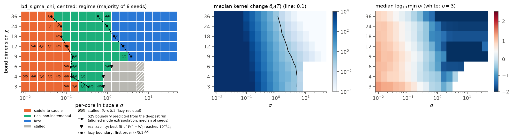

# regime-map: phase diagrams of TTN training regimes (Q5)

Status: working - Branch: agent/regime-map - Updated: 2026-10-09 20:15 UTC

## Summary
Task: phase diagrams of saddle-to-saddle (S2S) / rich / lazy dynamics over init scale sigma, bond
dimension chi, number of cores K and root imbalance, with predicted boundaries and threshold
sensitivity. **Interim (first sigma x chi diagram, binary N = 4):** all three boundaries are
predicted quantitatively. (i) The S2S boundary sigma_c(chi) is predicted per seed, to within one grid
step, by extrapolating each seed's deepest run with the aligned-mode theory; sigma_c falls from 0.25
(chi = 3) to 0.045 (chi = 36). (ii) The lazy boundary exists only at full bonds (chi >= 9 = cut
dimension); the first-order kernel-change law delta_K = kappa / sigma^K computed at init predicts it at
chi = 9-18 and underestimates it at chi >= 24, where x = ||W*|| / sigma^K is not small. (iii) Below the
cut dimension the centred target is unrealizable and runs stall exactly at the best fit of W* + W_0
(exact SVD), so no lazy regime exists there. Threshold sensitivity follows the predicted laws (S2S
boundary x2.5 for rho 2 -> 5 at K = 3). Production sweeps (library integrator, N = 8, K = 3..15,
imbalance, large chi) are running.

## Results
**Interim, binary N = 4 (K = 3), d = 3, teacher [3, 2, 1], 6 seeds per point, 8 chi x 19 sigma,
centred model.** Dynamics: gradient flow, scipy RK45 rtol 1e-9 / atol 1e-14 (interim driver
`experiments/regime_map/pilots/interim.py`; conservation drift <= 4e-11); raw runs in
`/root/outputs/regime_map/b4_sigma_chi/`. Figure: `experiments/regime_map/results/phase_b4_sigma_chi_centred.png`
(also `_plain`, `_twocopy`, and `sensitivity_b4_sigma_chi_centred.png`). Produced by
`uv run python experiments/regime_map/plots.py sigma_chi b4_sigma_chi centred experiments/regime_map/results/lazy_pred_b4.csv`.

| chi | S2S boundary sigma_c (S2S fraction = 1/2) | predicted (aligned extrapolation from deepest run, median of seeds) | lazy boundary sigma_lazy (lazy fraction = 1/2) | predicted, first order (kappa/0.1)^(1/3) |
|---|---|---|---|---|
| 3 | 0.25 | 0.34 | none (stalled; lazy residual 0.45) | - |
| 4 | 0.13 | 0.13 | none (stalled) | - |
| 6 | 0.14 | 0.13 | none (stalled) | - |
| 9 (cut dim.) | 0.13 | 0.14 | 3.0 | 3.8 |
| 12 | 0.10 | 0.10 | 2.1 | 2.4 |
| 18 | 0.071 | 0.075 | 1.59 | 1.45 |
| 24 | 0.076 | 0.074 | 1.26 | 0.98 |
| 36 | 0.045 | 0.043 | 1.13 | 0.59 |

Threshold sensitivity (boundaries in sigma; grid step x1.585):

| chi | S2S rho>2 / >3 / >5 | ratio 2->5 (pred. 2.5) | lazy dK<0.05 / <0.1 / <0.2 | ratio (pred. 4^(1/3) = 1.59) |
|---|---|---|---|---|
| 3 | 0.34 / 0.25 / 0.16 | 2.2 | - | - |
| 9 | 0.19 / 0.13 / 0.074 | 2.5 | 4.7 / 3.0 / 2.0 | 2.4 |
| 18 | 0.11 / 0.071 / 0.045 | 2.5 | 2.0 / 1.59 / 1.26 | 1.6 |
| 36 | 0.056 / 0.045 / 0.022 | 2.5 | 1.26 / 1.13 / 0.83 | 1.5 |

Other interim findings (N = 4):
- **Realizability (derived + empirical).** For chi < 9 the centred final loss equals the best
  rank-chi fit of W_0 + W* (exact SVD, all runs to 3 digits), and the stall onset (triangles) is where
  that fit reaches 1e-3 L_0 (sigma ~ 0.8-1.3). At large sigma the final loss equals the lazy residual
  ||P_perp W*||^2 / ||W*||^2 computed at init (0.486 vs 0.488, 0.254 vs 0.253).
- **Lazy law.** At sigma >= 3 and chi >= 24 the measured delta_K equals kappa / sigma^3 (kappa from
  linear response at init) to < 1% (`results/lazy_pred_b4.csv`). kappa falls like chi^-3 under SP
  (fan-in, unit rates) and chi^-1 under NTK-type rates, as `notes/theory_regimes.md` R10 predicts.
- **Plain vs centred** (same grid): labels agree in 96.5% of runs; they differ where predicted: plain
  is not lazy at chi = 12 (its large-sigma kernel change kappa_plain = 0.24 > 0.1) and plain converges
  where the centred target is unrealizable (chi < 9, sigma ~ 1.6).
- **Two-copy cross-check.** Lazy side agrees in mechanism but delta_K ~ sigma^-2K (second order,
  measured ratio 1362 vs predicted 1372 between sigma = 3 and 10), so its lazy boundary is lower
  (0.80 vs 1.13 at chi = 36). S2S side differs: the two mirror copies escape at the same time and each
  learns half of components 1 *and* 2, merging events 1-2 at every sigma for chi >= 18 (S2S boundary
  0.015 vs 0.075 at chi = 24). The two-copy model is therefore not a faithful cross-check of the S2S
  boundary at large chi (empirical; `pilots/twocopy_mechanism.py`).

## What was done
1. Read brief, model, diagnostics, plan; merged `origin/main`.

## Decisions
1. **d = 3, odeco teacher [3, 2, 1]** (minimal d for 3 odeco components; keeps the cut dimension
   small: 9 for N = 4, 81 for the top cut of N = 8, so full bonds are reachable). Alternative d = 4/5
   would make full bonds unaffordable for N = 8.
2. **N = 4 bond dimensions uncapped** (`cap=False`), chi in {3,4,6,9,12,18,24,36}: chi = 9 is the
   cut dimension (full, square cores, ill-conditioned), chi > 9 are overparameterized bonds, which is
   what the brief's "up to 8x the teacher rank" requires. N = 8 uses capped bonds (bottom bonds <= 9),
   since uncapped middle cores chi^3 are unaffordable at chi = 81.
3. **Interim integrator.** The library's dynamics/runner had not landed when the first diagram was
   due, so the interim sweeps use scipy RK45 (rtol 1e-9, atol 1e-14) on the flat parameter vector,
   as the brief allows for pilots, with an explicit time budget (README). They will be rerun or
   spot-checked with `ttn.dynamics` when it lands.
4. **All pilot results computed before the core-fix merge (teacher stream bug) were discarded**; the
   pilots had used teacher seed 1000 + s vs init seed s, but every number in this report is from
   runs after merging 57d5262.
5. **Stalled runs are split** (in figures only; the official label stays "stalled") into
   delta_K < 0.1 (kernel-like stall at the lazy residual, a representability effect) and
   delta_K >= 0.1 (feature-learning stall), because below the cut dimension the centred target
   W* + W_0 is unrealizable (theory R6) and "stalled" otherwise mixes two different mechanisms.
6. **Teacher seed = 1000 + init seed**, so seeds vary both; by the O(d) invariance of the init the
   teacher basis is statistically irrelevant, so this costs nothing and avoids any shared stream.
7. **Event widths are re-measured in linear time.** A log-time recording grid (1% spacing) cannot
   resolve O(1)-wide events at late times (at t ~ 4e5 on K = 7 the spacing is ~1e4), which made rho
   come out 1000x too small. Each final rise is re-integrated from the saved parameters on a
   200-point linear grid (`run_regime.refine_events`); deep-S2S widths then match the aligned theory
   to 3 digits (0.466, 0.798, 2.010 vs 0.46, 0.80, 2.01 for s = 3, 2, 1, K = 3).
8. **Integrators.** LSODA (exact Hessian) where P <= ~2500 (all of sigma x K; N = 8 with chi <= 12),
   dopri5 otherwise; N = 8 runs with large P start at sigma = 0.3-0.4, where later plateaus are still
   ~1e2-1e3 time units (deep S2S for K = 7: rho ~ 3 (0.9/sigma)^5).
9. **sigma_min(K) = 10^(-8/K)** in the sigma x K sweep so that initial component amplitudes ~sigma^K
   stay ~1e-8 or larger, far above the float64 floor of the gradient (lead's note); runs record the
   smallest dormant overlap at the first event (`dormant_min`).
10. **Interim scipy sweep superseded.** The first N = 4 sigma x chi map (2460 runs, scipy RK45) is
    kept in /root/outputs/regime_map/b4_sigma_chi as an integrator cross-check; all reported numbers
    come from the library runs (ttn.dynamics) with event refinement.

## Files left on the machine
- `/root/outputs/regime_map/` raw outputs (none yet).

## Caveats and next steps
- Interim numbers come from the scipy driver with a log-time recording grid; deep-S2S widths there are
  grid-limited (overestimated by up to ~0.5 at t ~ 20, so rho is underestimated far from the
  boundary; near the boundary events occur at t <= 5 where the grid is fine). The production rerun
  uses the library integrator with linear-time event refinement.
- Running: sigma x chi for N = 8 (incl. full bonds chi = 81 and 2x-overparameterized 18/162),
  sigma x K (binary N = 4, 8, 16; MPS N = 4..12), then imbalance (alpha x lambda), large chi
  (sp / ntk / muP-TTN, N = 4 to chi = 128, N = 8 to chi = 32).

## Log
- 18:18 started; read brief and notes; merged origin/main; machine has ~368 CPUs (cgroup quota), 125 GB RAM
- 18:25 theory draft in notes/regime_map.md: centred-model lazy limit only fits W* at maximal bond dimension (lazy residual), delta_K ~ kappa/sigma^K, rho ~ sigma^-(K-2), imbalance rule
- 18:30 pilot (scipy RK45) binary N=4 sigma x chi, 2 seeds: S2S at small sigma, lazy at large sigma for chi >= 9; final loss = best rank-chi approx of W0+W* (exact); delta_K matches kappa/sigma^3 to <1% at sigma >= 3 when converged
- 18:45 merged main (core fixes: teacher stream, cancellation-free centred loss); discarded old pilots; read literature.md (H4 corrections) and draft theory_regimes.md (agrees with my derivations; adds muP-TTN, exact aligned S2S boundary)
- 18:52 launched interim sweep b4_sigma_chi (N=4, centred/plain/two-copy, 8 chi x 19 sigma x 6 seeds = 2736 runs)
- 19:10 interim N=4 map: S2S / rich / lazy (chi >= 12) / stalled (chi < 9, unrealizable); per-seed S2S boundary predicted within one grid step by aligned-mode extrapolation from the deepest run; two-copy merges events 1-2 (mirror copies escape together)
- 19:20 merged library v0; wrote run_regime.py + sweep.py + YAML configs; found log-grid width resolution problem, added linear-time event refinement
- 19:54 launched production sweeps (library): sigma_chi_b8 (462), sigma_K (768), sigma_chi_b4 (2736); queued imbalance_b4, large_chi_b4, large_chi_b8
- 20:05 LSODA fails at huge sigma^K (K = 15, sigma = 10); added auto method (LSODA below sigma 0.7) with dopri5 fallback, max_steps caps, trimmed sigma ranges where deficient-bond runs only stall; relaunched (390 + 666 + 2736 runs)
- 20:15 interim report: N = 4 sigma x chi map with predicted S2S, lazy and realizability boundaries
